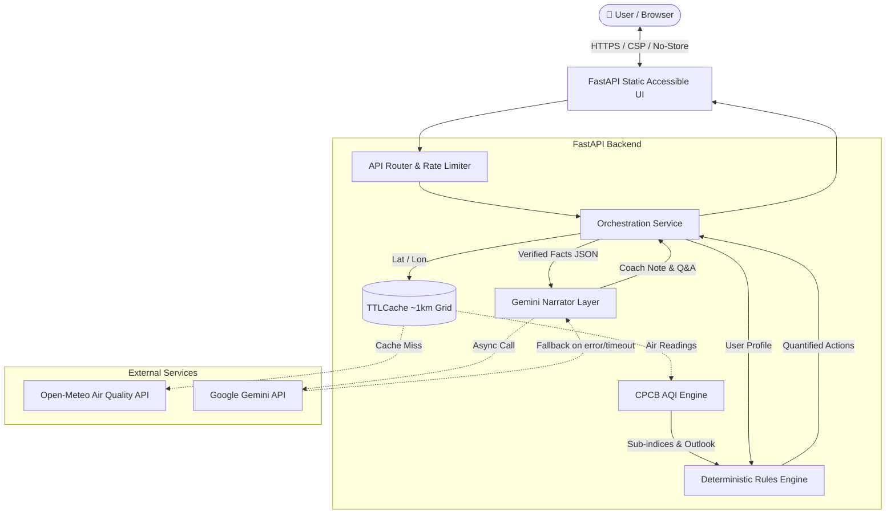

<div align="center">

# 🌿 AirWise: Urban Air Quality Assistant

**Personalized, low-emission daily routines and indoor air safety hacks powered by live air quality data.**

[](https://python.org)
[](https://fastapi.tiangolo.com)
[](https://ai.google.dev/)
[](https://open-meteo.com)
[](https://pytest.org)
[](https://github.com/astral-sh/ruff)
[](https://opensource.org/licenses/MIT)

<h3>
  <a href="https://airwise-xg65.onrender.com/">🌐 Launch Live Demo</a>
  <span> · </span>
  <a href="https://airwise-xg65.onrender.com/docs">📖 Interactive API Docs</a>
  <span> · </span>
  <a href="#-quickstart">⚡ Quickstart</a>
</h3>

---

</div>

## 📌 Overview

During severe winter smog across urban India, generic air warnings like *"Air Quality is Hazardous — Avoid Going Outside"* often lead to helplessness rather than actionable protection. People still need to commute, cook, air out their homes, and safeguard vulnerable family members.

**AirWise** transforms live particulate forecasts into a **prioritized, quantified personal action plan**:
1. **Live CPCB AQI Calculation**: Computes real-time Indian Central Pollution Control Board (CPCB) AQI from live PM2.5, PM10, NO2, and Ozone concentrations.
2. **Optimal Outdoor Window**: Analyzes a 48-hour hourly outlook to identify the day's cleanest window for errands versus peak pollution hours.
3. **Quantified Impact**: Computes concrete metrics for every decision (e.g. *"saves 10.1 kg CO₂e weekly on your 12 km commute"* or *"AQI 78 at 3 PM vs 330 at 7 AM"*).
4. **Resilient AI Coaching**: Google Gemini narrates verified facts into an encouraging daily coach note and answers follow-up lifestyle questions.
5. **100% Offline-Resilient**: Core calculations and advice rules are strictly deterministic and unit-tested; the system falls back seamlessly even without an API key or internet access to Gemini.

---

## 🚀 Key Features

- **🎯 Personalized Lifestyle Profiling**: Adapts to commute mode (car, bike, public transport, walking), distance, cooking fuel (LPG, induction, biomass), purifier ownership, outdoor exercise habits, and vulnerable household members (children, elderly, respiratory conditions).
- **📋 3-Pillar Prioritized Action Plan**:
  - **🏃 Daily Routine**: Identifies best hours for errands, N95 mask necessity, and switching outdoor workouts indoors.
  - **🏡 Indoor Air Protection**: Optimal ventilation hours, cooking exhaust protocols, wet cleaning hacks, and purifier sizing.
  - **🌱 Greener Alternatives**: Transit swaps, carpooling, work-from-home emission savings, and smoke reduction.
- **💬 Conversational Follow-Up Q&A**: Sanitized, fenced chat interface allowing users to ask specific questions (e.g., *"Is it safe for my toddler to play outside today?"*).
- **🛡️ Enterprise-Grade Guardrails**: Anti-hallucination prompt architecture, prompt-injection defense, strict schema validation (`extra=forbid`), and Content Security Policy (CSP).
- **♿ Inclusive & Accessible (WCAG)**: Keyboard-operable ARIA tabs, screen-reader live regions, skip links, contrast-tested palette, and automatic light/dark mode.

---

## 🏗️ Architecture & Data Flow



### Project Structure

```text
airwise/
├── app/
│   ├── advisor.py       # Deterministic rules engine & quantified impact calculators
│   ├── airdata.py       # Open-Meteo client, data validation, and spatial TTL caching
│   ├── aqi.py           # Indian CPCB AQI breakpoints, sub-indices, & hourly outlook
│   ├── config.py        # Typed runtime settings with zero-dependency .env loader
│   ├── llm.py           # Gemini integration, prompt fences, & graceful fallbacks
│   ├── main.py          # FastAPI application, security headers, & rate limiters
│   ├── ratelimit.py     # Sliding-window per-client rate limiter
│   ├── schemas.py       # Pydantic v2 strict models (extra=forbid)
│   ├── service.py       # Report assembly & fact verification pipeline
│   └── static/          # Accessible vanilla UI (HTML, CSS, JS; zero inline scripts)
├── scripts/
│   └── check_ai.py      # Diagnostic CLI for testing Gemini API connectivity & .env
├── tests/               # 86 comprehensive offline tests (Mocked network & LLM)
├── Dockerfile           # Production container configuration
├── pyproject.toml       # Linter (Ruff) and build configuration
└── requirements.txt     # Production dependencies
```

---

## 🔒 Trustworthy & Safe GenAI Design

AirWise treats generative AI as a **narrator of verified facts**, not an unconstrained oracle:

| Potential Risk | Defensive Implementation |
| :--- | :--- |
| **Hallucinated Numbers** | Gemini only receives a structured JSON of deterministic facts computed by tested Python code. The system prompt strictly forbids inventing values or statistics. |
| **Prompt Injection** | User input is length-capped (300 chars), stripped of control characters/HTML tags, and isolated inside `<user_question>` tags. System instructions forbid role changes or rule leakage. |
| **User Privacy** | Exact GPS coordinates and names are **never** passed to Gemini. Only the city name and anonymous lifestyle flags are included in the prompt. |
| **Service Outages & Latency** | Calls timeout after 12 seconds. Any failure (network, quota, invalid key) automatically falls back to deterministic rule-based text without user interruption. |
| **Medical Liability** | Medical diagnosis is explicitly rejected. Health-related guidance concludes with an advisory to consult a medical professional. |

---

## ⚡ Quickstart

### Prerequisites
- Python 3.12+ (or Python 3.14)
- A free Google Gemini API key ([Google AI Studio](https://aistudio.google.com/apikey)) *(Optional: the app runs 100% locally with rule-based fallbacks without a key)*

### 1. Clone & Set Up Virtual Environment

```bash
git clone https://github.com/Manasa-L-Hegde/Airwise.git
cd Airwise

# Create virtual environment
python -m venv .venv

# Activate environment
# On Windows:
.venv\Scripts\activate
# On Linux / macOS:
source .venv/bin/activate
```

### 2. Install Dependencies

```bash
pip install -r requirements-dev.txt
```

### 3. Configure Environment

Copy the template configuration file:

```bash
# Windows:
copy .env.example .env
# Linux / macOS:
cp .env.example .env
```

Open `.env` and set your Gemini API key (no quotes, no spaces):

```ini
GEMINI_API_KEY=your_gemini_api_key_here
GEMINI_MODEL=gemini-3.5-flash-lite
```

### 4. Verify AI Configuration

Run the built-in diagnostic utility to verify connectivity:

```bash
python scripts/check_ai.py
```

### 5. Launch Application

```bash
uvicorn app.main:app --reload
```

Open your browser to:
- **Web App**: [http://127.0.0.1:8000](http://127.0.0.1:8000)
- **Interactive API Docs**: [http://127.0.0.1:8000/docs](http://127.0.0.1:8000/docs)
- **Health Check**: [http://127.0.0.1:8000/api/health](http://127.0.0.1:8000/api/health)

---

## 📡 API Reference

### Health Check
```http
GET /api/health
```
**Response:**
```json
{
  "status": "ok",
  "version": "1.0.0",
  "ai_enabled": true,
  "ai_status": "ready",
  "ai_last_error": null
}
```

### Geocoding Search
```http
GET /api/geocode?q=Delhi
```
Returns autocompleted coordinates and regions across India and worldwide.

### Generate Daily Plan
```http
POST /api/assist
Content-Type: application/json
```
```json
{
  "location": { "lat": 28.65, "lon": 77.23, "name": "Delhi" },
  "profile": {
    "commute_mode": "car",
    "commute_km": 12.0,
    "has_children": true,
    "has_elderly": false,
    "has_respiratory_condition": false,
    "has_purifier": false,
    "cooking_fuel": "lpg",
    "exercises_outdoors": true
  },
  "use_ai": true
}
```

### Follow-up Q&A
```http
POST /api/ask
Content-Type: application/json
```
```json
{
  "location": { "lat": 28.65, "lon": 77.23, "name": "Delhi" },
  "profile": { ... },
  "question": "Is it safe for my child to play outdoors today?"
}
```

---

## 🧪 Testing & Code Quality

The test suite runs **100% offline** using mock HTTP transports and mock LLM generators:

```bash
# Run 86 test cases across AQI maths, advisor logic, LLM safety, & API endpoints
pytest

# Run fast code linting and style checks
ruff check .
```

---

## 🐳 Docker & Cloud Deployment

### Run with Docker

```bash
# Build Docker image
docker build -t airwise .

# Run container
docker run -p 8000:8000 --env-file .env airwise
```

### Deploy to Google Cloud Run

```bash
gcloud run deploy airwise \
  --source . \
  --region asia-south1 \
  --allow-unauthenticated \
  --set-env-vars GEMINI_API_KEY=your_key,GEMINI_MODEL=gemini-3.5-flash-lite
```

---

## 🛡️ Security & Privacy Standards

- **Strict CSP Headers**: Zero inline scripts or styles (`script-src 'self'`).
- **Network Hardening**: `X-Content-Type-Options: nosniff`, `X-Frame-Options: DENY`, `Referrer-Policy: no-referrer`.
- **Sliding-Window Rate Limiting**: Per-client IP limits preventing abuse (stricter thresholds on LLM generation endpoints).
- **Payload Caps**: 8 KB body limit on incoming JSON requests.
- **Zero Coordinate Leakage**: Precise latitude/longitude coordinates stay within the backend and are never sent to external AI providers.

---

## 📄 License & Attribution

- **License**: Released under the [MIT License](LICENSE).
- **Air Quality Data**: Powered by the [Open-Meteo Air Quality API](https://open-meteo.com/) (Copernicus Atmosphere Monitoring Service - CAMS).
- **AQI Formulation**: Indian National Air Quality Index standards published by the Central Pollution Control Board (CPCB).
- **Disclaimer**: AirWise provides general environmental wellbeing and low-emission guidance. It does not provide clinical or medical diagnoses.
